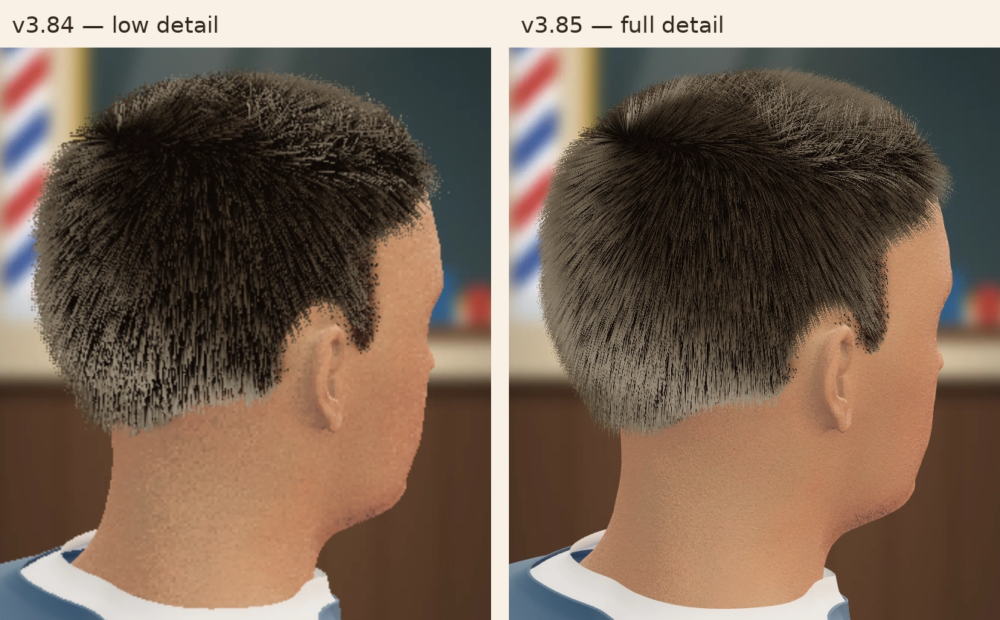

# MediaCube v3.85 full-detail graphics validation

Prepared 2026-10-15 UTC. New McPlay upload and physical-phone review pending.

## Change and rationale

v3.84 inherited the old Playables preset, which forced 1x/no-MSAA, simplified skin shaders,
14,000 scalp strands, five scalp segments, four beard segments and 45% beard density on every device.
The user reported visibly basic graphics on a phone. That visual trade-off was inappropriate for this
game's core appeal. v3.85 replaces it with a dedicated direct-YouTube graphics policy; it does not
reuse the Android detector that can classify a capable phone as low quality from coarse hardware hints.

The new renderer requests antialiasing at context creation, starts with 30,000 scalp strands, eight
segments for scalp/beard, full beard density and full skin/hair shaders. It starts at native DPR up
to 2x, with a 4,000,000-pixel drawing-buffer cap that is recalculated against actual canvas dimensions
on resize. That cap bounds the drawing buffer, not total multisample, driver or browser memory.

Performance adaptation uses measured frame intervals, a 1.5-second warm-up and one-second windows.
Two windows above 38 ms reduce resolution first in 0.25 steps (normally down to 1.5x), then scalp
count in 2,000-strand steps to a 24,000 floor. Three healthy windows below 26 ms gradually restore
quality. Native DPR and the drawing-buffer cap can require a lower effective resolution floor.
Normal 30 Hz pacing does not trigger a reduction. Host pause/resume resets sampling history; a single
long compilation stall has bounded influence. Full shaders, eight-segment geometry and full beard
density remain active at every adaptive setting. No overall low profile switch occurs.

The engine now redraws a static scene only when it changes. State clocks and RAF input handling
continue; cutting, rotation, reveal and falling hair remain animated. Control/customer changes,
final pointer release, final reveal/clippings, resize/resume and WebGL context restoration invalidate
the scene. The restoration listener is removed during teardown. This removes recurring idle GPU
work without downgrading the visual profile. A browser regression observes actual renderer calls,
then uses native guard/camera controls; a Chromium case loses/restores WebGL while idle.

All v3.84 cloud-save, startup-recovery, readiness, host pause/audio and ad handling remains in this target.
The legacy Playgama and Android graphics policies retain their existing behavior.

## Exact artifact

- `releases/asmr-barber-fade-master-v3.85-mediacube-youtube.zip`
- ZIP **401,398 bytes**, expanded **1,062,644 bytes**, **11 entries**.
- Largest entry: `runtime/game.js`, **760,463 bytes**.
- ZIP growth from v3.84: **552 bytes**.
- SHA-256: `c11e2599763ac8dbef2ba8db70a597c1e8fccdb735d23d1ba7cfa87c76f1f068`.
- Runtime commit: `5f6920fe04223309e4aa8c20ea96465536d0a091`.
- [CI run](https://github.com/lrodeveloperr/Haircut/actions/runs/38684281100)
- `BUILD-v3.85.json` records runtime-file hashes and final evidence.

## Results

| Check | Result |
| --- | --- |
| Existing game/Bridge contracts | 35/35 PASS |
| Direct YouTube SDK contracts | 28/28 PASS against extracted archive, locally and CI |
| Graphics policy tests | 8/8 PASS against extracted archive, locally and CI |
| Reproducible ZIP | PASS, byte-for-byte CI match |
| Chromium | 18/18 PASS, including idle GPU redraw and actual WebGL restoration regressions |
| Firefox | 16/16 PASS |
| WebKit | 16/16 PASS |
| Same-customer phone/tablet graphics comparisons | 3/3 PASS at phone DPR2/3 and tablet DPR2, including native controls and 4K resize |
| 27 viewports x four states | 27/27 PASS in Firefox/Mesa; same native actions and completion assertions |
| Sustained run | PASS, 50 customer transitions in 1,305,398 ms (21m45s), Chromium/SwiftShader |
| Independent graphics/platform review | No blocking findings; exact ZIP independently checked |
| Archive | PASS: valid CRC, root index.html, licenses, no test SDK/source/Bridge dependency |

The graphics suite compares the same saved customer in v3.84 and v3.85 at 390x844 DPR2, 360x640 DPR3
and 768x1024 DPR2. It checks actual WebGL antialiasing, full beard geometry/count, high-shader policy,
drawing-buffer dimensions, save continuity and resizing to a 4K CSS viewport. Screenshots establish
visible fidelity; they do not measure sustained physical-phone frame rate. Recorded startup times use
GitHub-hosted software rendering and the fixture SDK, not the real McPlay network or mobile GPU.

The sustained run kept one canvas, one HUD and three SDK callbacks throughout. JavaScript heap was
20,000,162 bytes at the start and 22,639,659 bytes at the end; these observations do not prove leak
freedom or bound total GPU/driver memory. No page or console errors were recorded. This was a
320x568 DPR1 software-rendered runner, not a physical-phone frame-rate benchmark.

A [Firefox/Mesa fallback soak](https://github.com/lrodeveloperr/Haircut/actions/runs/38686376104)
was started while GitHub still reported the slower Chromium job in progress. The primary job has
since passed; that additional observation is not needed for this release and was still running at
handoff. Its workflow/backend change does not alter the ZIP. Future sustained CI uses Firefox/Mesa.

## Visual evidence

The comparison is cropped from the 390x844 DPR2 CI screenshots of the same saved customer. No color,
lighting or sharpening edits were applied; the contact sheet is encoded as WebP for documentation.
The full screenshots are retained in the CI graphics artifact. Visual review confirms thinner,
more continuous hair strands, smoother head/neck/collar silhouettes and finer skin detail. The
360x640 DPR3 view was also reviewed. Neither image is a physical-phone photograph or FPS measurement.

Representative final screenshots were also reviewed at 225x400 (play), 390x844 (completion),
768x1024 (gown wardrobe), and 1440x900 (play), with no new clipping or missing geometry observed.
The [authoritative viewport run](https://github.com/lrodeveloperr/Haircut/actions/runs/38685418471)
uses Firefox/Mesa, covering all 27 sizes and four states with unchanged native interactions and
completion assertions. It changes no runtime or archive bytes.

## Candidate history

The initial full-graphics candidate retained recurring idle GPU redraws. Software-rendered Chromium
visual/layout captures timed out waiting for screenshots or stable controls; other engine integration
checks passed. Inspection found no CSS sizing oscillation. The final runtime fixes unnecessary idle
redraws and adds invalidation/context-recovery regressions. Initial candidate hashes/runs are not
release evidence for the final ZIP. The graphics capture once used a canonical flush instead of native
input for diagnosis; the final suite again uses native controls at phone DPR2/3 before comparing images.

The runtime's first final capture run passed both phone-DPR cases, then the tablet case hit a
10-second native-control timeout. Earlier layout cases also cascaded after screenshot timeouts.
The [capture-only follow-up](https://github.com/lrodeveloperr/Haircut/actions/runs/38684560076)
uses independent viewport sessions, a 30-second interaction timeout and a 60-second software-GPU
screenshot timeout. It changes no runtime or ZIP bytes; native-input and geometric assertions remain.

The longer Chromium capture run passed the phone/tablet graphics cases and 19/27 four-state viewport
cases. Eight larger dense-scene reveals exceeded the 45-second software-GPU completion timeout.
The reveal advances by at most 100 ms per rendered frame, so very slow software rendering can delay
its 1.5-second animation considerably; the quality policy retains full shaders/geometry deliberately.
Code inspection found no viewport-dependent pause/busy path. The subsequent Firefox/Mesa run passed
all 27 sizes without changing the actions, assertions or runtime. Chromium's large-viewport software
renderer timing remains a recorded limitation; those cases are not claimed as Chromium passes.
All three engines pass their complete mobile integration suites, and Chromium separately passes
native phone/tablet-DPR interaction and 4K drawing-buffer/state-preservation checks.

## Size and hosted scope

Every entry is below McPlay's reported 15 MB per-file advisory; ZIP and expanded runtime remain well
below the studio's 5,000,000-byte limits. The engine still exceeds YouTube's separate 512 KiB per-file
recommendation, an advisory documented in v3.84. No blocking individual-file size limit is approached.

Replace the old bundle with this exact ZIP, let McPlay rerun pre-flight, and review hair/skin clarity,
cutting responsiveness, orientation, reveal and sustained play on the actual phone. Browser CI and
static review cannot certify mobile GPU speed, battery/thermal behavior or live hosted ads/cloud saves.
Record any portal or phone observations against this archive's hash.
